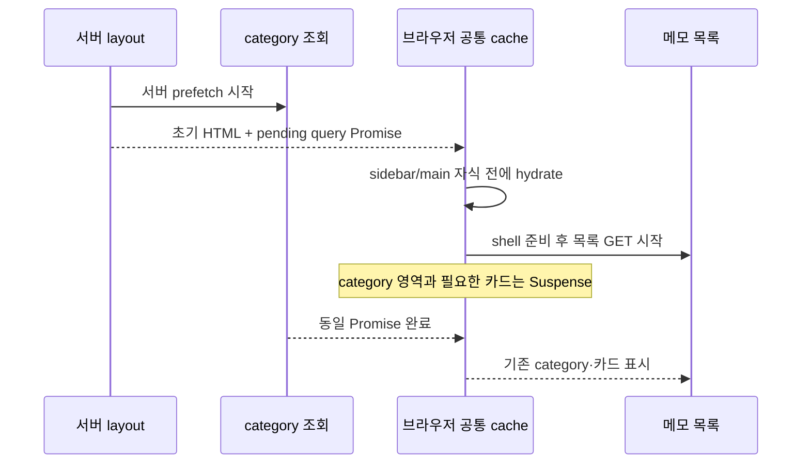

# 메모 화면의 카테고리 대기 분리

상태: **설계 확정 · 2026-10-29 08:45 · 사람 승인 (시안 포함)**. 사용자 응답: “ㄱㄱ 좋아”. 기존 DB-1256 진단 설계와 승인 이력을 보존한 후속 범위다.

작업카드: https://www.notion.so/40789de02fde814b9cc8f5d99d72fdda

시안: [상태·기기·테마 전환 HTML](mockups/memo-category-streaming.html), [데스크톱 로딩](mockups/memo-category-streaming-desktop.png), [모바일 메뉴·다크](mockups/memo-category-streaming-mobile-dark.png). 실제 계정 데이터·서비스 스크린샷이 아닌 합성 목업이다. 변경 전의 빈 영역은 초기 HTML 대기 구조를 표현하며 실제 사용자 화면의 캡처가 아니다.

## 한 줄 목표

서버 카테고리 조회가 느려도 기본 탐색·검색·메모 목록 요청이 먼저 시작되게 하며, 진행 중인 조회는 사이드바와 메모 카드가 공유한다.

## AS-IS

- `(sidebar)/layout.tsx:40`의 `HydrationBoundaryWrapper`가 `MemoSidebar` 전체를 감싼다. `HydrationBoundaryWrapper.tsx:14`는 category prefetch를 await한 뒤 내부 Suspense를 반환한다.
- 로컬 production build에서 category에만 500ms를 추가하자 워밍업 후 최종 HTML 응답이 508/510ms 늦어졌고, 제거 후 복원됐다. 운영 지연의 category 기여율을 뜻하지 않는다.
- `MemoCardFooter/useMemoCategoryPopover.tsx:45`와 `MemoOption.tsx:59`는 메뉴가 닫혀 있어도 `useCategoryQuery`를 호출한다. 메모 GET은 독립적이지만 카드 표시가 category 완료를 기다릴 수 있다.
- 서버 boundary를 category 영역으로 옮기기만 하면 main의 browser query가 먼저 시작할 수 있다. 동일 query key만으로 서버·브라우저 중복은 막을 수 없다.
- 현재 설치 버전은 React Query 5.90.21 / query-core 5.90.20이다. AGENTS의 스택 표에 있는 5.59.0과 차이가 있지만 이번 작업에서 패키지·스택 표를 변경하지 않는다.

## TO-BE

서버 category prefetch를 시작하고 await하지 않는다. category 전용 boundary가 pending Promise를 포함해 dehydrate하고, sidebar와 main의 공통 조상에서 자식보다 먼저 hydrate한다. 서버 요청별 QueryClient, 기존 category query key와 5분 staleTime을 유지한다. 공통 `HydrationBoundaryWrapper`의 다른 호출자는 바꾸지 않는다.

`MemoSidebar`의 바깥 Sidebar와 정적 메뉴·휴지통·설정은 유지하고 category 영역에만 Suspense를 둔다. pending에는 비대화형 Skeleton을 표시한다. 메인에는 기존 목록 Skeleton이 표시되고, category가 필요한 카드가 계속 기다릴 수 있다. 성공 기준은 shell·목록 GET의 선행 시작이며 category 미완료 상태의 완성 카드 표시가 아니다.

## 변경 지점

아래 line은 설계 시점의 checkout 기준이다.

| 태그 | 위치 | 변경 목적 |
| --- | --- | --- |
| FE | `apps/web/src/app/[lng]/(auth)/(sidebar)/layout.tsx:40` | category pending hydration을 sidebar+main 공통 조상에 조합 |
| FE | `apps/web/src/app/[lng]/(auth)/(sidebar)/_components/CategoryHydrationBoundary.tsx` (신규) | await 없는 category prefetch·category만 선택한 pending dehydration |
| FE | `apps/web/src/app/[lng]/(auth)/(sidebar)/_components/MemoSidebar/index.tsx:24` | category 영역에만 Suspense fallback 배치 |
| FE | `apps/web/src/app/[lng]/(auth)/(sidebar)/_components/MemoSidebar/SidebarCategorySkeleton.tsx` (신규) | 같은 category 슬롯의 결정적 Skeleton |
| 공통 | 관련 단위·브라우저 회귀 및 로컬 측정 harness | category gate·server/browser 요청 수·최종 상태·수치 검증 |

FE 모듈 이름은 구현 시 기존 export 패턴에 맞추되 경계와 동작 계약은 유지한다. BE API·DB 스키마 변경은 없다.

## 동작 명세

| 조건 | 사이드바 | 메인·요청 | 판정 |
| --- | --- | --- | --- |
| category pending | 정적 메뉴 유지, category 영역만 Skeleton | 검색·기존 목록 Skeleton, memo GET 시작 가능 | gate 해제 전 shell과 GET 관측 |
| category 성공 | 기존 순서·색·활성·개수·추가/편집/삭제 | 준비된 데이터를 기존 카드와 공유 | 최종 UI·상호작용 동일 |
| 정상 빈 category | 기존 제목·설정·추가 버튼, 항목 0 | 메모 정상 처리 | 오류로 분류하지 않음 |
| Supabase `{data:null,error}` | 기존 값·로깅 계약 유지 | 성공 빈 결과와 별도 실패 표본 기록 | 새 오류 문구나 오류 은폐 없음 |
| 실제 Promise reject | 기존 retry·오류 경계 계약 검증 | pending 무한 유지 금지 | RSC 전송·재시도까지 별도 회귀 |
| 이미 캐시가 있는 refetch·편집 | category section 임의 remount 금지 | 입력·편집 ID·최신 mutation 결과 유지 | 늦은 hydration으로 새 데이터 복원 금지 |
| 모바일 | 닫힌 Sheet는 숨김, 열면 정적 메뉴+category Skeleton | 기존 전체 폭과 메뉴 trigger 유지 | Sheet 18rem·닫기·메뉴 이동 검증 |

데스크톱 Sidebar는 기존 12rem, 접힌 상태 3rem을 유지한다. category fallback은 기존 `id="category"` 슬롯에 32px 제목 placeholder, 48px 추가행 placeholder, 고정 폭의 32px 행 3개를 둔다. `aria-busy`를 사용하고 장식은 aria-hidden, 가짜 버튼·추가/선택 행동은 만들지 않는다. `SidebarMenuSkeleton`의 임의 폭 대신 결정적 `Skeleton`을 사용한다. semantic 색·현재 CSS radius·폰트·기존 grid Skeleton을 따른다. 새 노출 문구가 필요해지면 승인 시안 범위부터 다시 확인하고 i18n 키를 사용한다.

## 범위 밖

- 인증 middleware 검증 삭제·약화, 사용자 쿠키·토큰 추출, 실제 메모 변경.
- 카드의 category 의존 제거, 팝업 지연 로딩, 메모 SSR 도입, 전체 레이아웃 재설계.
- 설정 페이지의 별도 await나 모든 공유 라우트의 속도 개선 보장.
- DB 인덱스·GA/Faro/Sentry 이벤트 변경·새 의존성·전역 QueryProvider 교체.
- 로컬 결과를 운영 개선율로 환산하거나 초기 1xx 응답을 최종 HTML 응답으로 표시.

## 자동 결정과 사전 확인

`web-memo:interview --auto`로 정리한 결정이다. 사람의 시각 시안 승인을 대체하지 않는다.

| 항목 | 채택 | 다른 선택지 | 근거 | 되돌리는 비용 |
| --- | --- | --- | --- | --- |
| pending 데이터 전달 | category 전용 공통 ancestor에서 pending Promise hydration | 단순히 category subtree로 await 이동 | main 카드 소비자의 선행 browser 요청 방지 | 중간 |
| 데이터 조회 위치 | 기존 서버 prefetch 유지 | 서버 조회 삭제 후 browser 전용으로 교체 | 인증·데이터 경로 변경 최소화 | 중간 |
| 로딩 표현 | category 부분 Skeleton, 정적 Sidebar 유지 | 전체 Sidebar spinner | 너비·기본 메뉴를 유지하고 가짜 조작 방지 | 낮음 |
| 캐시·오류 | 기존 key/staleTime·값 의미 유지, 실제 rejection 별도 검증 | 전역 Provider·공통 wrapper 변경 | 관련 없는 라우트 영향 제한 | 중간 |

사전 합성 실험에서 pending query dehydrate→hydrate→동일 key fetchQuery가 server fetch 1 / browser fetch 0으로 PASS했다. 실제 Next RSC Promise 전송은 아직 구현·검증하지 않았으므로 완료로 간주하지 않는다. 목업 4상태·모바일 2모드·가로 위치·JS 오류 0을 확인했다.

## 구현 후 검증 기준

1. category gate를 닫아도 첫 HTML에 기본 탐색·검색 shell이 있고 memo GET이 시작된다. 기존 빌드에서는 이 회귀가 실패해야 한다.
2. 서버 category 1회와 browser category 0회를 구분해 세며 pending Promise를 JSON으로 옮기지 않는다. 브라우저가 이미 요청 중인 내부 이동은 별도 조건으로 검증한다.
3. category gate 해제 후 같은 결과·순서·활성 표시가 반영된다. empty·오류 값·실제 rejection·재시도·mutation 중 hydration 경합을 따로 검증한다.
4. 기존 category 편집·메모 카드 옵션·설정·모바일 Sheet 동작을 확인한다. 결과 캐시를 account 간 전역 singleton으로 바꾸지 않는다.
5. 동일 로컬 production 조건에서 최종 응답 헤더·shell·첫 memo GET·content ready를 전후 비교한다. 1xx와 finalResponseHeadersStart를 분리한다.
6. 변경 범위의 단위/E2E·typecheck·check/lint·build 후 develop 배포와 기존 PR 갱신. 새 이벤트 필요 여부를 검토하고 없으면 +0으로 기록한다.

## 근거

- [설치 버전에 대응하는 공식 SSR streaming 문서](https://github.com/TanStack/query/blob/08050cb3ebb693ccf782558ba863fd5ff3df2e38/docs/framework/react/guides/advanced-ssr.md#streaming-with-server-components)
- [query-core pending Promise hydration 구현](https://github.com/TanStack/query/blob/7ac4e20ddb4ae50357fe8ad91d5397740a58847c/packages/query-core/src/hydration.ts#L197-L265)
- 운영·로컬 숫자 기록: Notion 측정 문서 https://www.notion.so/40789de02fde8100a433f1f29b8cdf05
